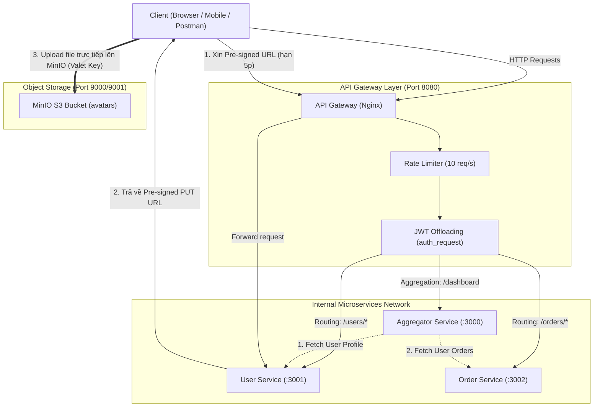

# Hệ Thống Microservices & API Gateway (Kiến Trúc Phần Mềm)

> Stack này chạy cùng lab WAF tại thư mục cha. Host port của API Gateway là `8081` và Aggregator là `3003`; các port còn lại `3001`, `3002`, `9000`, `9001`. WAF/Juice Shop của thư mục cha giữ `8080`/`3000`. Tất cả host port chỉ bind `127.0.0.1`. Chạy `pwsh -File evidence/evaluate-gateway.ps1` từ thư mục cha và xem `evidence/REPORT.md` để biết kết quả đo. Các ví dụ dùng `8080`/`3000` bên dưới cần thay bằng `8081`/`3003` khi chạy stack này.

Dự án thực hành bài tập về nhà môn **Kiến trúc phần mềm** (Chủ đề: *Thiết kế cho bảo mật & API Gateway Patterns*).

Hệ thống bao gồm **2 microservice** (`User Service`, `Order Service`), **1 Aggregator Service (BFF)**, **1 Object Storage MinIO (S3)** và **1 API Gateway (Nginx / Node.js)** đáp ứng đầy đủ 5 yêu cầu cốt lõi theo đề bài:

1. **Routing**: Định tuyến `/users` và `/orders` tới đúng microservice.
2. **Offloading**: Kiểm tra JWT tập trung và giới hạn tốc độ **10 request/giây** tại API Gateway.
3. **Aggregation**: Endpoint `/dashboard` gộp dữ liệu người dùng và đơn hàng tương ứng trong 1 request duy nhất.
4. **Valet Key**: Upload ảnh đại diện trực tiếp lên MinIO bằng **Pre-signed URL hết hạn sau 5 phút (300s)**.
5. **Latency Benchmark**: Đo lường và so sánh độ trễ khi đi qua Gateway so với gọi trực tiếp microservice.

---

## 1. Sơ đồ Kiến trúc Hệ thống



---

## 2. Chi tiết 5 Design Patterns đã triển khai

### Pattern 1: Gateway Routing
- **Khái niệm**: Client chỉ cần biết một địa chỉ duy nhất của API Gateway (`http://localhost:8080`). Gateway phân tích đường dẫn URL và header để chuyển tiếp request tới đúng service nội bộ.
- **Triển khai**:
  - `GET/POST /users/...` $\rightarrow$ Định tuyến tới `http://user-service:3001`
  - `GET/POST /orders/...` $\rightarrow$ Định tuyến tới `http://order-service:3002`
- **Lợi ích**: Ẩn giấu topology mạng nội bộ, cổng và địa chỉ IP của các service, cho phép tái cấu trúc backend mà không ảnh hưởng client.

### Pattern 2: Gateway Offloading
- **Khái niệm**: Đưa các tác vụ bảo mật, xác thực và kiểm soát lưu lượng dùng chung lên Gateway, giải phóng tài nguyên tính toán cho các service nghiệp vụ.
- **Triển khai**:
  1. **JWT Verification Offloading**:
     - Gateway sử dụng cơ chế `auth_request` trong Nginx để xác thực JWT tập trung.
     - Nếu token thiếu hoặc không hợp lệ, Gateway lập tức phản hồi `401 Unauthorized` và chặn request ngay tại cửa ngõ.
     - Nếu token hợp lệ, Gateway giải mã và truyền thông tin user (`X-User-Id`, `X-User-Email`, `X-User-Role`) vào backend.
     - Các route công khai (`/users/login`, `/users/register`) được cấu hình `auth_request off;`.
  2. **Rate Limiting Offloading**:
     - Gateway cấu hình `limit_req_zone $binary_remote_addr zone=gateway_rate_limit:10m rate=10r/s;` với `limit_req_status 429;`.
     - Giới hạn cứng **10 request/giây**. Khi client gửi vượt ngưỡng, Gateway phản hồi `429 Too Many Requests`.

### Pattern 3: Gateway Aggregation (BFF)
- **Khái niệm**: Thay vì client trên di động phải thực hiện nhiều lượt gọi mạng qua lại (chatty I/O), Gateway gọi song song các microservice và gộp kết quả trả về trong 1 payload duy nhất.
- **Triển khai**:
  - Endpoint `GET /dashboard` tiếp nhận request từ client có kèm token JWT.
  - Gateway gọi đồng thời (`Promise.allSettled`):
    - `user-service`: Lấy thông tin tài khoản, email, ảnh đại diện.
    - `order-service`: Lấy danh sách lịch sử đơn hàng của người dùng.
  - Tổng hợp dữ liệu thành 1 payload JSON duy nhất kèm các chỉ số thống kê (`totalOrders`, `totalSpent`, `orderStatuses`).
  - Hỗ trợ **Fault Tolerance**: Nếu 1 service gặp sự cố, vẫn trả về kết quả từng phần (Partial Response) mà không làm sập toàn bộ trang dashboard.

### Pattern 4: Valet Key Pattern
- **Khái niệm**: Cấp cho client một "chìa khóa có hạn" (Pre-signed URL) để tải file trực tiếp lên kho lưu trữ (MinIO S3), ứng dụng và Gateway không phải làm trung gian truyền tải file nặng.
- **Triển khai**:
  - Client gửi `POST /users/avatar/presigned-url` tới Gateway.
  - `user-service` sử dụng S3 Client sinh URL PUT có chữ ký số với thời gian hết hạn **chính xác 5 phút (300 giây)**:
    ```javascript
    const presignedUrl = await getSignedUrl(s3Client, command, { expiresIn: 300 });
    ```
  - Client nhận URL và gửi HTTP `PUT` kèm dữ liệu ảnh trực tiếp lên `http://localhost:9000/avatars/...`.
  - Client gọi `POST /users/avatar/confirm` để lưu URL ảnh đại diện vào hồ sơ người dùng.
- **Lợi ích**: Tiết kiệm băng thông, CPU và bộ nhớ cho Gateway và App Server, ngăn ngừa tắc nghẽn khi nhiều người dùng tải file dung lượng lớn cùng lúc.

### Pattern 5: Latency Benchmark (Đo độ trễ)
- Kịch bản đo lường gồm 50 request gọi liên tiếp tới:
  1. Trực tiếp User Service: `http://localhost:3001/users/profile`
  2. Qua API Gateway: `http://localhost:8080/users/profile`
- **Kết quả thực tế đo được**:
  - Trực tiếp: ~9.89 ms
  - Qua Gateway: ~11.69 ms
  - Độ trễ tăng thêm (Overhead): **+1.81 ms (+18.3%)**
- **Đánh giá kiến trúc**: Độ trễ tăng nhẹ do Gateway phải xử lý thêm 1 chặng mạng (network hop) và thực thi kiểm tra Rate Limit + giải mã JWT. Đánh đổi này là hoàn toàn xứng đáng để đổi lấy khả năng bảo mật tập trung, ngăn ngừa tấn công DDoS và che giấu kiến trúc backend.

---

## 3. Cấu trúc Thư mục Dự án

```
KTPM/
├── docker-compose.yml              # Cấu hình khởi chạy toàn bộ hệ thống (5 containers)
├── package.json                    # Scripts chạy test, benchmark, standalone
├── README.md                       # Tài liệu hướng dẫn chi tiết
├── gateway/
│   ├── Dockerfile                  # Container Nginx API Gateway
│   ├── nginx.conf                  # Cấu hình Nginx (Routing, Rate limit 10r/s, JWT Offloading, Aggregation)
│   ├── package.json                # Dependencies cho standalone gateway
│   └── standalone-gateway.js       # API Gateway viết bằng Node.js (dành cho chạy không cần Docker)
├── services/
│   ├── user-service/
│   │   ├── Dockerfile
│   │   ├── package.json
│   │   └── server.js               # Service quản lý User, sinh JWT, cấp Pre-signed URL MinIO 5 phút
│   ├── order-service/
│   │   ├── Dockerfile
│   │   ├── package.json
│   │   └── server.js               # Service quản lý Đơn hàng
│   └── aggregator-service/
│       ├── Dockerfile
│       ├── package.json
│       └── server.js               # Service gộp dữ liệu User + Order cho /dashboard
└── scripts/
    ├── test-all.js                 # Kiểm thử tự động 100% 5 yêu cầu
    ├── test-all.ps1                # Kiểm thử tự động trên PowerShell
    ├── benchmark.js                # Kịch bản đo và so sánh độ trễ (ASCII report)
    ├── benchmark.ps1               # Kịch bản đo độ trễ trên PowerShell
    └── start-standalone.js         # Khởi chạy toàn bộ services cục bộ
```

---

## 4. Hướng dẫn Chạy Hệ thống

### Cách 1: Sử dụng Docker Compose (Khuyến nghị)

Chỉ cần một lệnh duy nhất:
```bash
docker compose up --build -d
```

Các dịch vụ sẽ sẵn sàng tại:
- **API Gateway (Nginx)**: `http://localhost:8080`
- **User Service (Direct)**: `http://localhost:3001`
- **Order Service (Direct)**: `http://localhost:3002`
- **Aggregator Service (BFF)**: `http://localhost:3000`
- **MinIO S3 Storage API**: `http://localhost:9000`
- **MinIO Web Console**: `http://localhost:9001` (User: `minioadmin` / Pass: `minioadmin`)

Để dừng hệ thống:
```bash
docker compose down
```

---

### Cách 2: Chạy trực tiếp bằng Node.js (Không cần Docker)

Nếu không cài đặt Docker, bạn có thể chạy trực tiếp:
```bash
npm run start:standalone
```

---

## 5. Chạy Kiểm Thử & Đo Độ Trễ

### 1. Kiểm thử toàn diện tất cả tính năng (Test Suite)
Chạy kịch bản kiểm thử tự động 10 tiêu chí:
```bash
node scripts/test-all.js
# hoặc trên PowerShell:
.\scripts\test-all.ps1
```

**Kết quả mẫu**:
```text
================================================================
    KIỂM THỬ TỰ ĐỘNG HỆ THỐNG MICROSERVICES & API GATEWAY
================================================================
Gateway: http://localhost:8080

✅ PASS | 1.1 Gateway Routing: Định tuyến POST /users/login tới user-service
✅ PASS | 2.1 JWT Offloading: Chặn request khi thiếu token (HTTP 401)
✅ PASS | 2.2 JWT Offloading: Chặn request khi token không hợp lệ (HTTP 401)
✅ PASS | 2.3 JWT Offloading: Cho phép request khi có JWT hợp lệ (HTTP 200)
✅ PASS | 3.1 Gateway Routing: Định tuyến GET /orders tới order-service
✅ PASS | 4.1 Gateway Aggregation: Endpoint /dashboard gộp thành công User + Orders
✅ PASS | 5.1 Valet Key: Sinh Pre-signed URL thành công (Hết hạn sau 300 giây = 5 phút)
✅ PASS | 5.2 Valet Key: Client upload trực tiếp lên MinIO thành công (HTTP 200)
✅ PASS | 5.3 Valet Key: Cập nhật URL ảnh đại diện trong User Service thành công
✅ PASS | 6.1 Rate Limiting Offloading: Chặn khi vượt 10 request/giây (HTTP 429)

Kết quả: 10/10 bài test VƯỢT QUA (100%)
🎉 TẤT CẢ CÁC YÊU CẦU TRONG SLIDE ĐỀ BÀI ĐÃ ĐƯỢC THỰC THI CHÍNH XÁC!
```

---

### 2. Đo độ trễ (Benchmark Script)
Chạy kịch bản so sánh hiệu năng trực tiếp vs qua Gateway:
```bash
node scripts/benchmark.js
# hoặc trên PowerShell:
.\scripts\benchmark.ps1
```

**Bảng kết quả benchmark mẫu**:
```text
================================================================
                    KẾT QUẢ ĐO ĐỘ TRỄ
================================================================
| Chỉ số (Metric)       | Gọi Trực Tiếp (Direct) | Qua API Gateway   |
|-----------------------|------------------------|-------------------|
| Số lượng request      | 50                     | 50                |
| Min Latency           | 7.87 ms                | 9.01 ms           |
| Max Latency           | 12.83 ms               | 17.53 ms          |
| Average (Mean)        | 9.89 ms                | 11.69 ms          |
| Median (p50)          | 9.87 ms                | 11.53 ms          |
| 95th Percentile (p95) | 12.23 ms               | 15.75 ms          |
================================================================
  -> Độ trễ tăng thêm (Overhead):  +1.81 ms (+18.3%)
================================================================
```

---

## 6. Danh Sách Endpoint & Hướng Dẫn Sử Dụng API

### 1. Đăng nhập lấy JWT (Public)
```bash
curl -X POST http://localhost:8080/users/login \
  -H "Content-Type: application/json" \
  -d '{"email":"vana@example.com","password":"password123"}'
```

### 2. Lấy hồ sơ người dùng (Protected - JWT Offloading)
```bash
curl -X GET http://localhost:8080/users/profile \
  -H "Authorization: Bearer <TOKEN_CỦA_BẠN>"
```

### 3. Lấy danh sách đơn hàng (Protected - Gateway Routing)
```bash
curl -X GET http://localhost:8080/orders \
  -H "Authorization: Bearer <TOKEN_CỦA_BẠN>"
```

### 4. Lấy dữ liệu Dashboard gộp (Protected - Gateway Aggregation)
```bash
curl -X GET http://localhost:8080/dashboard \
  -H "Authorization: Bearer <TOKEN_CỦA_BẠN>"
```

### 5. Upload Avatar qua MinIO (Valet Key Pattern)
**Bước 1**: Xin Pre-signed URL (hạn 5 phút = 300s)
```bash
curl -X POST http://localhost:8080/users/avatar/presigned-url \
  -H "Authorization: Bearer <TOKEN_CỦA_BẠN>" \
  -H "Content-Type: application/json" \
  -d '{"filename":"my-photo.png","contentType":"image/png"}'
```
*Phản hồi chứa `uploadUrl` có chữ ký và `expiresInSeconds: 300`.*

**Bước 2**: Tải ảnh trực tiếp lên MinIO (bỏ qua App Server)
```bash
curl -X PUT "<UPLOAD_URL_TỪ_BƯỚC_1>" \
  -H "Content-Type: image/png" \
  --data-binary "@path/to/my-photo.png"
```

**Bước 3**: Xác nhận cập nhật hồ sơ
```bash
curl -X POST http://localhost:8080/users/avatar/confirm \
  -H "Authorization: Bearer <TOKEN_CỦA_BẠN>" \
  -H "Content-Type: application/json" \
  -d '{"objectKey":"<OBJECT_KEY_TỪ_BƯỚC_1>"}'
```
